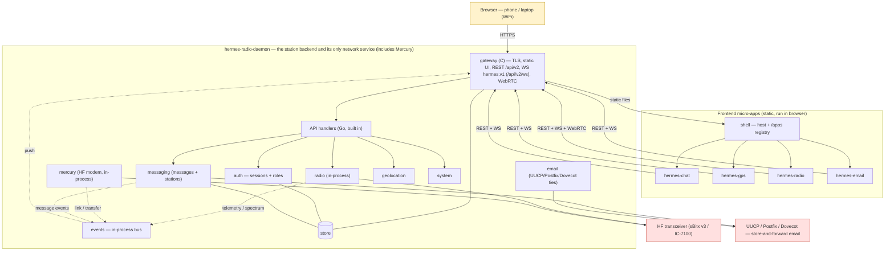

# HERMES Redesign — Complete Architecture

2026-10-09 · draft POC — structure only

The complete target architecture as one diagram. **Solid arrows** are
request/command flows; **dotted arrows** are event pushes (radio/modem →
in-process bus → gateway → WS subscribers). Companion to the contracts in
`contracts/`.

## Legend

- **Solid arrows** = request/command flow; **dotted arrows** = event push
  (via the in-process bus → gateway → WS subscribers).
- **radio and Mercury run in-process** inside hermes-radio-daemon (D-03, D-05);
  there is no WebSocket bridge between them.
- **No proxy in front** (2026-10-18): radiod terminates TLS and serves the UI, REST,
  the WebSocket and WebRTC itself. Its C core does all network I/O and hands each
  request or message to the **Go API handlers**, built into radiod as a library
  (`-buildmode=c-archive`), which call back into C for radio state (D-02, D-36).
- **`messaging`** spans chat and email — the same store-and-forward store;
  email's over-the-air path exits via **UUCP/Postfix**.
- **Voice** is not a separate service: it is the radio's audio, carried to the
  browser over WebRTC (Opus), with signaling on `hermes.v1` and media in radiod's C
  (libdatachannel). Audio never passes through Go (D-27).
- **Store** is the database engine; the choice between MariaDB and SQLite is
  open under D-01.

## Rendering

GitHub renders this diagram natively in `.md`. For the GitHub Pages hub, add
`mermaid.js`, or render to SVG with `mermaid-cli` — matching the existing
`architecture.svg` convention in `tech_docs/api-redesign/`.
